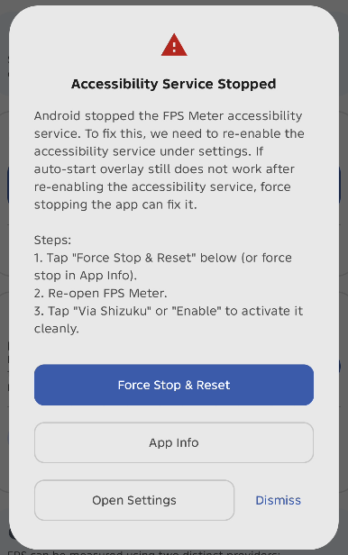

# Known Issues and Limitations

This document outlines known Android system behaviors, hardware restrictions, and recommended troubleshooting steps when using FPS Meter.

---

## Accessibility Service "Not working" on Android

### The Issue

On some Android devices, the operating system or aggressive OEM background memory managers may terminate background services. When this happens to the FPS Meter accessibility service, Android system settings may display:

> [!WARNING]
> **FPS Meter**  
> Not working. Tap for info.

  

### Why Toggling Settings Alone Does Not Always Work

When Android terminates an accessibility service unexpectedly, the system server places the component into an internal crashed list. Simply toggling the service off and on inside Android Accessibility Settings may leave this dead state lingering in the system server. As a result, the service may remain non-responsive or get stuck in a re-enable loop where auto-start fails to detect foreground games.

### The Solution: Force Stop and Re-enable

Completely force stopping the application purges dead service records from the Android system server, allowing the service to bind cleanly when reopened.

FPS Meter includes a guided recovery dialog when this state is detected:

  

#### Recovery Steps:

1. **If you use Shizuku**:
   - Tap **Force Stop & Reset** in the dialog or warning banner.
   - This automatically resets the service state and force stops the app.
   - Reopen FPS Meter and tap **Via Shizuku** to start the service cleanly.

2. **If you do not use Shizuku**:
   - Tap **App Info** in the dialog or warning banner (or go to your device **Settings > Apps > FPS Meter**).
   - Tap **Force stop** and confirm.
   - Reopen FPS Meter and tap **Enable** to turn the service on in Accessibility Settings.

3. **Preventing Future Background Terminations**:
   - In **App Info > Battery**, set battery usage to **Unrestricted**.
   - If your device manufacturer uses aggressive memory cleanup (such as MIUI/HyperOS, ColorOS, or OxygenOS), lock FPS Meter in your recent apps screen or allow auto-start in your system security manager.

---

## Hardware Frequency Limitations (GPU & RAM Clock Speeds)

### Android system restrictions (Non-root limitations)

While CPU frequency is readable without root, GPU and RAM frequencies are locked behind strict Android SELinux permissions on many modern chipsets (especially MediaTek). When running without root, the system simply returns permission denied.

### Root is required for full support

Full and reliable access to GPU and RAM clock speeds generally requires root access. However, this app is designed strictly for non-root users (using standard Android APIs and Shizuku). I also do not have a rooted device to develop or test root-specific features.

### Inconsistent hardware support across devices

Even if some specific chipsets or older devices expose certain paths, behavior varies heavily across Qualcomm, MediaTek, Unisoc, and Exynos. Without having each of those physical devices on hand to test and maintain, it would lead to broken or blank metrics (--Mhz) for many users.
